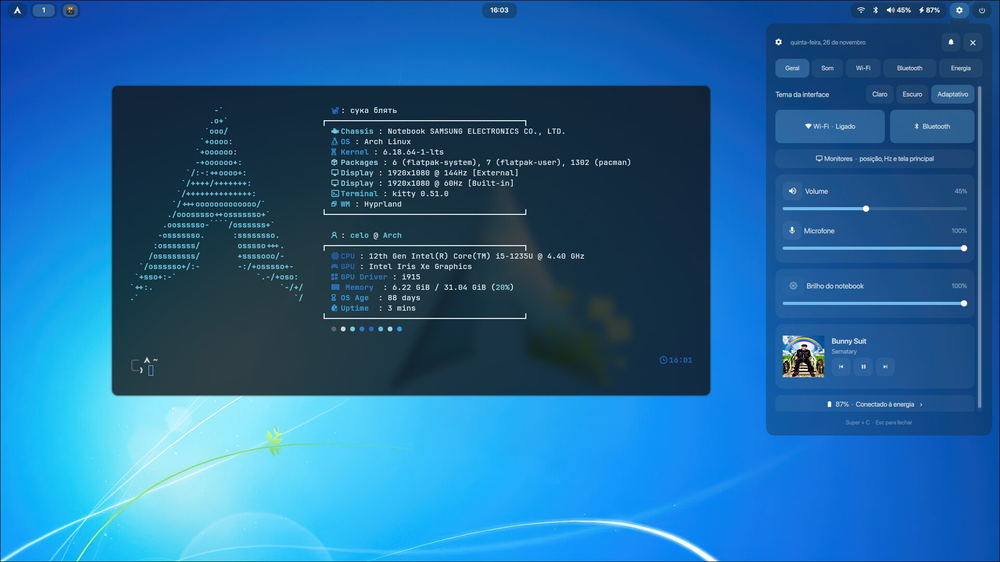
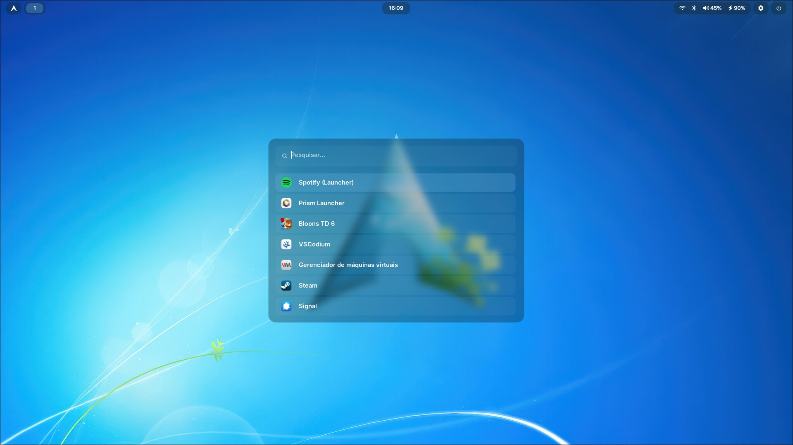
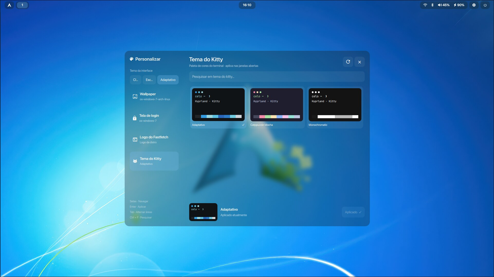
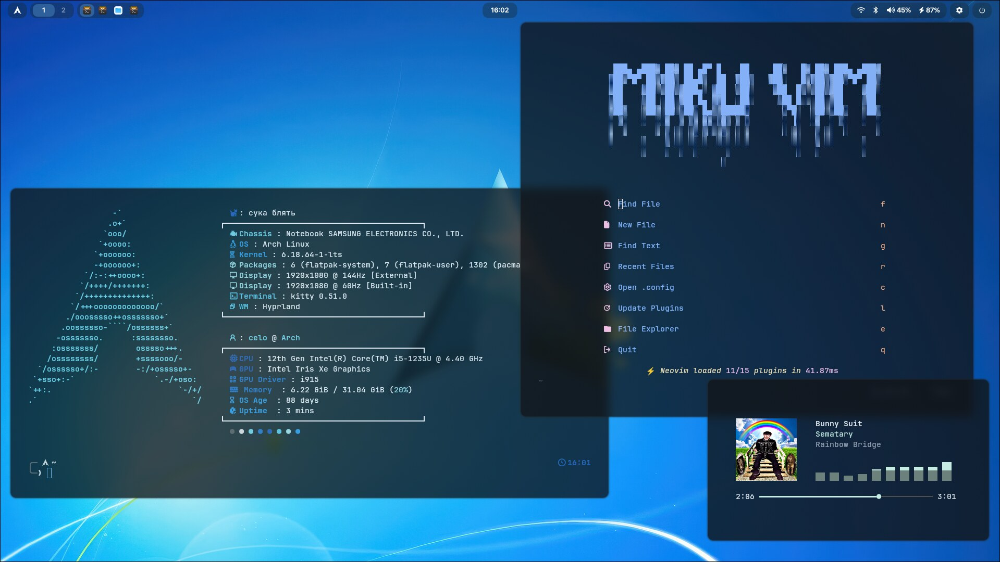

# Dotfiles · Hyprland + Quickshell

[Português](README.md) · **English**

Rice for Arch Linux with Hyprland, a glass interface and three themes: **Light**, **Dark** and **Adaptive**. Quickshell provides the bar, control center, notifications, calendar, player and monitor configurator. The screen locker also uses Quickshell, in a separate process.

| Component | Implementation |
| --- | --- |
| Compositor | Hyprland with Lua configuration |
| Bar, control center and notifications | Quickshell |
| Session lock | Quickshell + PAM; Hyprlock as fallback |
| Terminal | Kitty, with optional Adaptive theme |
| Applications and clipboard | Rofi + cliphist |
| Wallpaper | awww |
| Login | SDDM, with optional Astronaut theme |
| Files / browser / editor | Nautilus / Firefox / Neovim |
| System information | Fastfetch |

The bar uses WhiteSur icons, sliding indicators and panels attached to the buttons. The Adaptive theme extracts colors from the wallpaper and syncs the interface and Rofi. In Kitty, the Adaptive option also generates the 16 ANSI colors that appear as the dots in Fastfetch.

## Screenshots



| | |
| --- | --- |
|  |  |
| Launcher (`Super + Space`) | Customize (`Super + W`) |



The default wallpaper, `os-windows-7-arch-linux.jpg`, is included in the repository and applied on the first installation.

## Quick start

`Super` is the Windows key.

| Action | Shortcut |
| --- | --- |
| Terminal / applications | `Super + Enter` / `Super + Space` |
| Browser / files | `Super + B` / `Super + E` |
| Control center | `Super + C` |
| Customization (wallpaper, login, Fastfetch, Kitty) | `Super + W` |
| Configure monitors | `Super + Shift + D` |
| Lock the session | `Super + L` |
| Area screenshot to clipboard | `Super + Shift + S` |
| Close window / toggle floating | `Super + Q` / `Super + Z` |
| Go to workspace / move window | `Super + 1…0` / `Super + Shift + 1…0` |

On the bar, click the clock to open the calendar and the music widget to expand the player. Right-click the workspace numbers to see the window layout. On the volume control, the mouse wheel adjusts in 5% steps. The distro icon opens the shortcut search; right-click opens applications in Rofi.

## Installation

These settings require **Hyprland with Lua support** and the commands used by the monitor configurator, plus **Quickshell 0.3.2 or compatible**. They are not a configuration for old versions of Hyprland based only on `hyprland.conf`.

```sh
git clone https://github.com/MarceloAntonio/Dotfiles.git
cd Dotfiles
./install.sh --dry-run
./install.sh
```

Run as a regular user: the installer asks for `sudo` when it needs to install packages or configure system services. Read the [installation and migration guide](docs/migration.md) before applying it to an existing session. The default wallpaper comes with the repository; the full collection is in the separate repository [wallpapers_dotfile](https://github.com/MarceloAntonio/wallpapers_dotfile).

The installer uses Arch packages and installs the configurations and commands from this repository. Waybar, SwayNC and Pulsar are no longer part of the interface. Hyprlock remains available as an alternative lock and provides the PAM policy used by the new locker.

## What's included

- **Language:** the system ships in English (`en_US.UTF-8`); switch to Português under Control center → General. The choice changes the system locale (`pt_BR.UTF-8` or `en_US.UTF-8`) and translates the interface immediately; other applications change on the next login.
- **Control center:** per-application audio, output/input selection, Wi-Fi, Bluetooth, brightness, battery and power profiles.
- **Notifications:** popups, session history, click actions and Do not disturb.
- **Calendar and music:** keyboard navigation, cover art, controls, horizontal player and bars that react to audio.
- **Customization:** wallpaper, SDDM background, Fastfetch logo and Kitty themes; double-click applies.
- **Monitors:** drag-to-position, resolution, Hz, scale and primary preference; 20-second preview with automatic revert.
- **Lock:** wallpaper, clock, discreet password field, PAM authentication and suspend integration.

The monitor configurator has isolated validation and revert tests. The locker was loaded in preview and with locking disabled for validation; real authentication, suspend/resume and monitor connection during lock need interactive verification on the target machine.

More details in [interface usage](docs/usage.md), [architecture and diagnostics](docs/architecture.md) and [installation and migration](docs/migration.md).

## References

- [ViegPhunt/Dotfile](https://github.com/ViegPhunt/Dotfile)
- [SDDM Astronaut Theme](https://github.com/Keyitdev/sddm-astronaut-theme)
- [WhiteSur Icon Theme](https://github.com/vinceliuice/WhiteSur-icon-theme)
