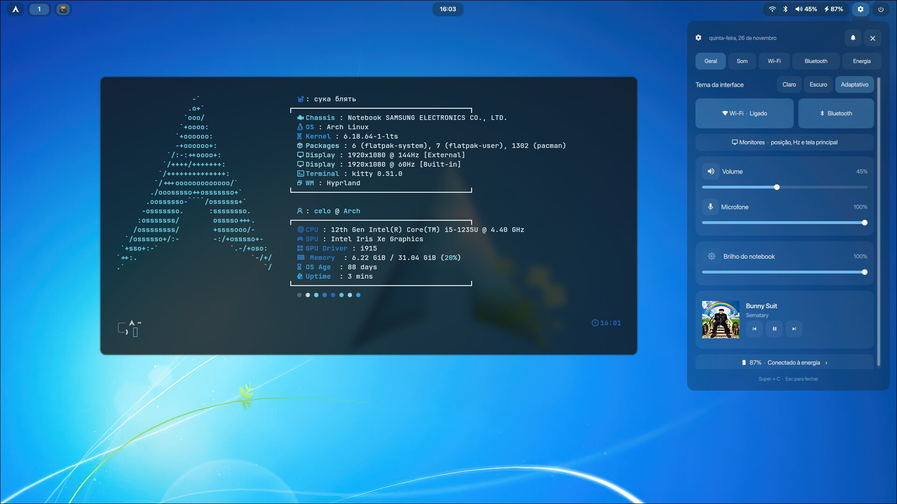
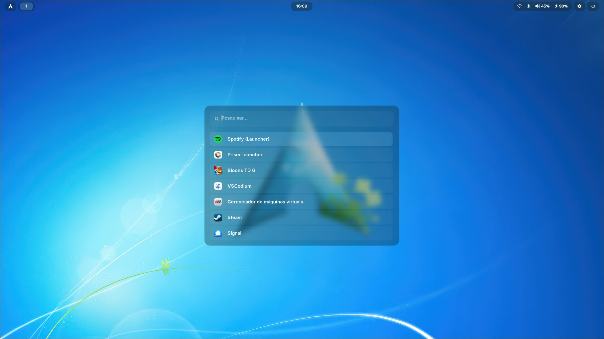
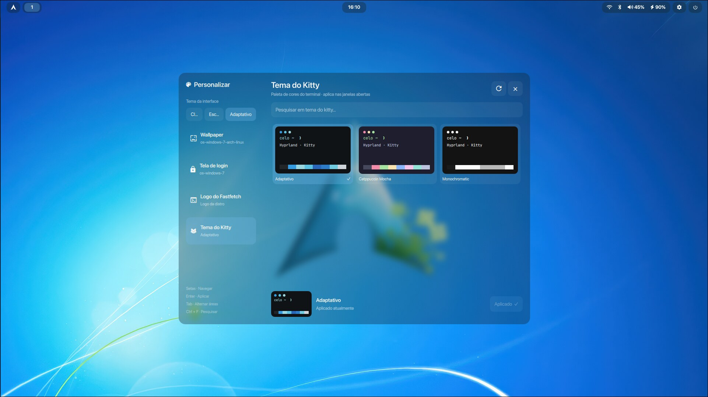
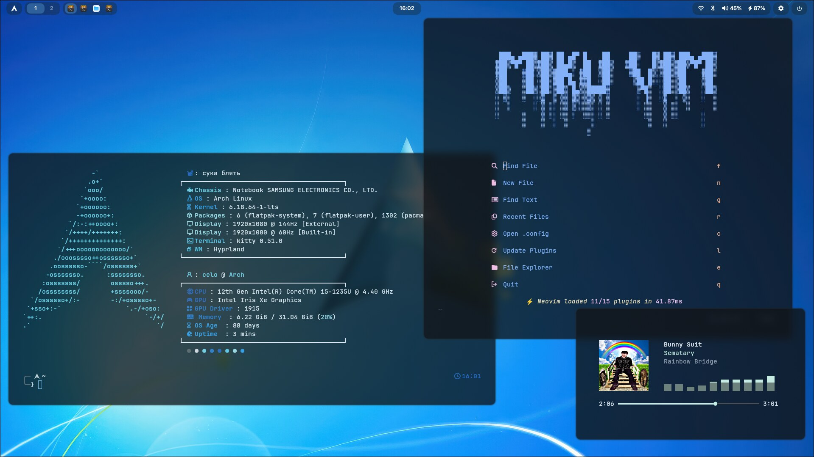

# Dotfiles · Hyprland + Quickshell

**Português** · [English](README.en.md)

Rice para Arch Linux com Hyprland, interface de vidro e três temas: **Claro**, **Escuro** e **Adaptativo**. O Quickshell reúne a barra, central de controle, notificações, calendário, player e configurador de monitores. O bloqueador de tela também usa Quickshell, em um processo separado.

| Componente | Implementação |
| --- | --- |
| Compositor | Hyprland com configuração Lua |
| Barra, central e notificações | Quickshell |
| Bloqueio de sessão | Quickshell + PAM; Hyprlock como alternativa |
| Terminal | Kitty, com tema Adaptativo opcional |
| Aplicativos e clipboard | Rofi + cliphist |
| Wallpaper | awww |
| Login | SDDM, com tema Astronaut opcional |
| Arquivos / navegador / editor | Nautilus / Firefox / Neovim |
| Informações do sistema | Fastfetch |

A barra usa ícones WhiteSur, indicadores deslizantes e painéis conectados aos botões. O tema Adaptativo extrai cores do wallpaper e sincroniza a interface e o Rofi. No Kitty, a opção Adaptativo gera também as 16 cores ANSI que aparecem nas bolinhas do Fastfetch.

## Capturas de tela



| | |
| --- | --- |
|  |  |
| Launcher (`Super + Espaço`) | Personalizar (`Super + W`) |



O wallpaper padrão, `os-windows-7-arch-linux.jpg`, vem no repositório e é aplicado na primeira instalação.

## Uso rápido

`Super` é a tecla Windows.

| Ação | Atalho |
| --- | --- |
| Terminal / aplicativos | `Super + Enter` / `Super + Espaço` |
| Navegador / arquivos | `Super + B` / `Super + E` |
| Central de controle | `Super + C` |
| Personalização (wallpaper, login, Fastfetch, Kitty) | `Super + W` |
| Configurar monitores | `Super + Shift + D` |
| Bloquear a sessão | `Super + L` |
| Screenshot de área para o clipboard | `Super + Shift + S` |
| Fechar janela / alternar flutuante | `Super + Q` / `Super + Z` |
| Ir para workspace / mover janela | `Super + 1…0` / `Super + Shift + 1…0` |

Na barra, clique no relógio para abrir o calendário e na música para expandir o player. Clique direito nos números dos workspaces para ver a disposição das janelas. No volume, a roda do mouse ajusta em passos de 5%. O ícone da distro abre a busca de atalhos; clique direito abre os aplicativos no Rofi.

## Instalação

Estas configurações exigem **Hyprland com suporte a Lua** e aos comandos usados pelo configurador de monitores, além de **Quickshell 0.3.2 ou compatível**. Elas não são uma configuração para versões antigas do Hyprland baseadas somente em `hyprland.conf`.

```sh
git clone https://github.com/MarceloAntonio/Dotfiles.git
cd Dotfiles
./install.sh --dry-run
./install.sh
```

Execute como usuário normal: o instalador solicita `sudo` quando precisa instalar pacotes ou configurar serviços do sistema. Leia o [guia de instalação e migração](docs/migracao.md) antes de aplicar em uma sessão existente. O wallpaper padrão vem junto; a coleção completa fica no repositório separado [wallpapers_dotfile](https://github.com/MarceloAntonio/wallpapers_dotfile).

O instalador usa pacotes do Arch e instala as configurações e comandos deste repositório. Waybar, SwayNC e Pulsar deixaram de fazer parte da interface. Hyprlock continua disponível como alternativa de bloqueio e fornece a política PAM usada pelo bloqueador novo.

## O que está incluído

- **Idioma:** o sistema vem em inglês (`en_US.UTF-8`); troque para Português em Central → Geral. A escolha muda o locale do sistema (`pt_BR.UTF-8` ou `en_US.UTF-8`) e traduz a interface na hora; os outros aplicativos mudam no próximo login.
- **Central:** áudio por aplicativo, escolha de saída/entrada, Wi-Fi, Bluetooth, brilho, bateria e perfis de energia.
- **Notificações:** popups, histórico da sessão, ações ao clicar e Não perturbe.
- **Calendário e música:** navegação por teclado, capa, controles, player horizontal e barras que reagem ao áudio.
- **Personalização:** wallpaper, fundo do SDDM, logo do Fastfetch e temas do Kitty; duplo clique aplica.
- **Monitores:** posição por arraste, resolução, Hz, escala e preferência principal; prévia de 20 segundos com reversão automática.
- **Bloqueio:** wallpaper, relógio, campo de senha discreto, autenticação PAM e integração com suspensão.

O configurador de monitores tem testes isolados de validação e reversão. O bloqueador foi carregado em prévia e com bloqueio desativado para validação; autenticação real, suspensão/retomada e conexão de monitores durante o bloqueio precisam de verificação interativa na máquina de destino.

Mais detalhes em [uso da interface](docs/uso.md), [arquitetura e diagnóstico](docs/arquitetura.md) e [instalação e migração](docs/migracao.md).

## Referências

- [ViegPhunt/Dotfile](https://github.com/ViegPhunt/Dotfile)
- [SDDM Astronaut Theme](https://github.com/Keyitdev/sddm-astronaut-theme)
- [WhiteSur Icon Theme](https://github.com/vinceliuice/WhiteSur-icon-theme)
